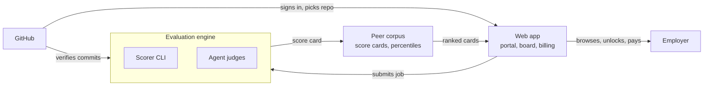

# Employee Evaluator — Design Doc

As of 2026-10-18 · Paul Jensen (Ghost in the Kernel Labs)

Living copy: https://claude.ai/code/artifact/cf29d855-202b-4e79-97c3-324d0434e08a

## Pitch

Employee Evaluator ranks developers by the AI-assisted codebase they actually built, so employers hire from verified work instead of resumes and live-coding interviews.

**The problem, phrased for the buyer.** Every resume is now AI-polished and most read identically. Screeners cannot read ten thousand of them, and the ones they do read do not predict performance. Live coding measures typing speed under pressure; it does not measure the skill that now matters, which is directing an AI agent to build and maintain real software.

**What the platform does.**

1. Applicants sign in with GitHub and submit one repository they built with AI assistance.
2. The evaluation engine scores the repository on seven metrics (see Scoring rubric) and verifies that the applicant built it (see Provenance).
3. Applicants are ranked per metric. Employers browse anonymized score cards and pay to unlock the identities and repositories of the candidates they want.
4. Employers who unlock a candidate agree to a response guarantee: every unlocked candidate gets a decision within a fixed window, or the employer loses access. This is the no-ghosting rule, and it is the price of admission.

**Why employers pay.** They get a pre-ranked shortlist backed by real code, cheaper than a recruiter fee and faster than a screening pipeline. Candidates pay nothing.

**Tone note.** The internal version of this pitch is angrier than this. The public version attacks the process (resumes, live coding, volume) and never the people, because the people are the ones signing the contract.

## Architecture

Three components: the web app (the website and the GitHub app are one thing), the evaluation engine, and the rubric the engine implements. The rubric is a document and a set of fixtures, not a service.

The web app owns identity and money; the engine owns judgment; the peer corpus is the only state they share. GitHub is read by both: the web app for sign-in and repo selection, the engine for commit verification.

| Component | Responsibility | Phase |
| --- | --- | --- |
| Rubric | Metric definitions, calibration fixtures, score-card schema | 1 |
| Scorer CLI | Tool-computable metrics and provenance from a repo path | 1 |
| Agent judges | Judgment metrics and the navigability task, via the Claude Agent SDK | 2 |
| Peer corpus | Score-card store, tooling buckets, percentile ranks | 2 |
| Web app | GitHub OAuth, submission flow, employer board, unlocks, response guarantee | 3 |

**Languages (decided 2026-10-18):** Java 21 for the engine and API, TypeScript for the web frontend, Python for the thin agent-runner worker. At scale (tens of thousands of submitters) the bottleneck is model API cost and the sandbox fleet, not the orchestration language.

## Provenance

Provenance is a score, not a gate: a submission with weak evidence is shown to employers as **unverified** rather than rejected, and the employer decides what that is worth.

**Layer 1 — Identity.** GitHub OAuth is the only sign-in. The applicant's GitHub account is the identity on the score card, and the submitted repository must be owned by that account or by an organization where the account is a member.

**Layer 2 — Authorship.** Commit author is a free-text field and can be forged with one flag. What GitHub actually verifies is the push and the commit signature. The engine checks:

| Check | Source | Effect on score |
| --- | --- | --- |
| Commit signed with a GPG or SSH key registered to the account | GitHub commit verification API | Full credit |
| Commit unsigned but pushed by the account | GitHub events / push log | Partial credit |
| Commit authored by a different GitHub user | Commit metadata | Reduces applicant's share of the codebase |
| Commit author not matching any GitHub account | Commit metadata | Counts as unverified |

**Layer 3 — History shape.** Commit count is trivial to fake (squash a stolen repo, replay it as 300 commits in an evening). The shape of a history is much harder to fake. The engine computes a plausibility score from:

- Spread: commits across days or weeks, not clustered in one session
- Diff variance: a mix of 2-line fixes, 400-line features and wide refactors, not uniform chunks
- The messy middle: reverts, typo fixes, half-done work followed by cleanup
- Tests landing beside the code they test, not all at the end
- Agent fingerprints: commit-message style, co-author trailers, `CLAUDE.md` / `AGENTS.md` and architecture notes that an agent-driven workflow produces

The agent-fingerprint signal does double duty: a maintained AI-navigability layer is both a maintainability signal and evidence the person was actually working with an agent.

**Layer 4 — Follow-up session (deferred).** The one case the history cannot catch is a stronger friend driving the applicant's laptop under the applicant's account. The fix is a recorded 30-minute session where the applicant extends their own submission with an agent while the session log is captured. This is not live coding; it is "prove you can drive this codebase." Phase 1 skips it. Later, employers can request it per candidate.

**Provenance score.** Weighted sum of the three computed layers, 0–100, displayed as Verified (≥ 80), Partial (50–79) or Unverified (< 50). Weights are a tuning question; starting point 30 / 30 / 40 for identity / authorship / shape.

## Scoring rubric

Seven metrics, each 0–100, each ranked separately; there is no single composite score, because employers hire for different things and a composite hides the trade-offs.

| Metric | What it measures | How it is computed | Judge |
| --- | --- | --- | --- |
| Quality | Correctness, test coverage, error handling, idiomatic use of the language | Static analysis + test run + agent review, normalized against the peer corpus (same agent tooling) | Tools + agent |
| Complexity | Difficulty of the problem actually solved | Cyclomatic / cognitive complexity of core modules, dependency graph depth, agent assessment of the hard parts | Tools + agent |
| Size | Amount of working software | Lines, files, modules, excluding vendored and generated code | Tools |
| Ambition | How hard the stated goal was | Agent judgment against a calibrated rubric (toy / utility / product / research) using README, issues and commits | Agent, calibrated |
| AI navigability | How easily an agent with little context can work in the repo | Presence and accuracy of `CLAUDE.md` / architecture notes, module boundaries, naming consistency, measured by an agent cold-start task | Agent task |
| Maintainability | How safely the code can be changed | Coupling, duplication, test-to-code ratio, refactor history in commits | Tools + agent |
| Provenance | Confidence the applicant built it | See Provenance section | Tools |

**Normalization against bloat.** Size and Complexity are raw measures and reward padding on their own. The score card therefore shows them raw but ranks on *efficiency ratios*: Quality per thousand lines and Maintainability per unit of Complexity. A 40,000-line mess loses to a 6,000-line clean solution to the same problem.

**Peer corpus.** Quality is relative: a repo built with Claude Code is compared with other repos built with Claude Code. The corpus starts empty. Cold-start plan: seed it with public agent-built repositories and our own (Suite Builder, Katana, Flight Recorder), and publish absolute scores until the corpus is large enough for percentile ranks (target: 200 repos per tooling bucket).

**Calibration.** Ambition and the agent half of Quality are judgment calls. Each needs a set of human-labeled examples (start with 30) that the judging prompt is tested against before it scores a live submission. Re-run the calibration set whenever the judging prompt or model changes, and record the drift.

**AI navigability as a task, not a checklist.** The most honest measure is to hand the repo to a fresh agent with a small, realistic change request and measure how many tool calls and how much context it needs to make the change correctly. That is the metric; the checklist items are the cheap proxy for phase 1.

**Score card.** One row per submission: seven scores, the three efficiency ratios, the provenance tier, the tooling bucket, and the date. The anonymized card is what employers browse.

## Anonymity and IP protection

Employers never see code or identity until they pay, and candidates never see which employers looked.

| Tier | Who sees it | What is shown | Cost |
| --- | --- | --- | --- |
| Public board | Any signed-in employer | Anonymized score cards: seven scores, ratios, provenance tier, tooling bucket, language, rough project category | Free |
| Unlock | Paying employer, per candidate | GitHub identity, repository link, the engine's written review | Per unlock, and the response-guarantee clock starts |
| Session | Paying employer, per candidate, optional | The recorded follow-up session (Provenance layer 4) | Per session |

**IP protection.** The platform stores a snapshot of the repository only as long as scoring takes, then keeps the score card and the review. It never re-hosts the code. An unlock grants a link to the candidate's own repository, so the candidate controls visibility and can make it private again after the hiring round.

**Anonymization limits.** A score card plus a project category can still identify someone with an unusual project. The public board therefore shows category at coarse grain ("developer tooling", "data pipeline") and never the README or any identifying text.

**Response guarantee.** Every unlock starts a clock (proposed: 10 business days). The employer must mark the candidate as advanced, declined, or hired. Miss the clock and the employer's board access is suspended until they catch up. Candidates see the status, not the employer name, until the employer chooses to reveal it.

## Phase 1 — Rubric and scorer CLI (Opus plan)

Phase 1 delivers a command-line scorer that takes a repository path and emits a score card for the four tool-computable metrics plus provenance layers 2 and 3. No agents, no web app. It is testable on our own repos from the first week.

**Repo:** this one, with the scorer in `packages/scorer`. Language: Java 21, Gradle, JUnit 5.

**Steps, each one Opus session:**

1. Scaffold the repo with `CLAUDE.md`, architecture notes, lint, test runner, and an empty `score` command. Record the refactor cadence in `CLAUDE.md` (every fifth session is a navigability pass).
2. Repo ingestion: clone or read a local path, detect languages, exclude vendored and generated code, produce a file inventory. Output the Size metric.
3. Static analysis adapters: one adapter interface, first implementations for TypeScript and Python (tree-sitter), producing cyclomatic and cognitive complexity per function and the dependency graph. Output the Complexity metric.
4. Maintainability: coupling, duplication (token-shingling), test-to-code ratio. Output the Maintainability metric and the two efficiency ratios.
5. Test runner adapter: detect and run the repo's own tests in a sandbox, capture pass rate and coverage. Feed the tool half of Quality.
6. Git history analysis: spread, diff variance, revert and fixup detection, test co-location, agent fingerprints. Output provenance layer 3.
7. GitHub adapter: commit verification status and push attribution via the API. Output provenance layer 2.
8. Navigability checklist: `CLAUDE.md` / `AGENTS.md` presence and freshness (does it name modules that still exist?), module boundary consistency. Output the proxy navigability score.
9. Score card JSON schema plus a Markdown renderer. Run the scorer on Suite Builder, Katana and Flight Recorder and commit the cards as the first corpus entries.
10. Navigability pass: refactor for the agent, tighten `CLAUDE.md`, delete dead paths.

**Done when:** `evaluator score <path>` runs on three of our repos and the numbers survive a sanity read.

## Phase 2 — Evaluation engine with Anthropic agents (Opus plan)

Phase 2 adds the judgment metrics (Ambition, the agent half of Quality, Complexity assessment) and the real navigability task, run by Claude agents through the Claude Agent SDK, and wraps the scorer in a job queue. The Agent SDK ships in TypeScript and Python, so the agent runner is a small Python worker (`packages/agent-runner`) that the Java engine calls over the queue: it receives a job, runs one agent, and returns structured JSON. Everything else stays in Java.

**Design rule:** every agent judgment is a structured output against a written rubric, checked against the calibration set before it touches a live submission. The agent explains its score in prose; the prose becomes the employer-facing review.

**Steps, each one Opus session:**

1. Calibration set: hand-label 30 repos on Ambition (toy / utility / product / research) and Quality (1–5). Store as fixtures. This is Paul's work, not Opus's; Opus builds the fixture format and the scoring harness.
2. Judge harness: a runner that feeds a repo summary (inventory, README, sampled files, commit log) to a judging prompt and parses structured output. Measure agreement with the calibration set; iterate the prompt until agreement is above an agreed floor (start: 80 %).
3. Ambition judge: prompt plus harness run. Output the Ambition metric.
4. Quality judge: reviews sampled core modules for correctness, error handling and idiom; combines with the phase 1 test and lint results. Output the final Quality metric.
5. Navigability task: a fresh agent in a sandbox receives the repo and a small change request generated from the repo's own issues or README. Measure tool calls, tokens and whether the change passes the repo's tests. Output the real Navigability metric; retire the phase 1 proxy.
6. Peer corpus store: SQLite first, score cards keyed by tooling bucket; percentile computation once a bucket has enough entries.
7. Job queue: submissions run as isolated jobs with timeouts, cost caps per job, and a sandbox that cannot reach the network except GitHub. Record cost per evaluation; that number sets the unlock price floor.
8. Review renderer: the agent's prose plus the score card into the employer-facing review document.
9. Navigability pass on the engine itself.

**Done when:** a submitted repo URL produces a complete seven-metric score card and review inside a cost cap we are willing to pay per applicant.

**Security note:** submitted repositories are untrusted input. The judging agents must treat README text, comments and commit messages as data, never as instructions, and the sandbox must assume the repo is hostile.

## Phase 3 — Web app with GitHub integration (Opus plan)

Phase 3 is one web application: GitHub OAuth for applicants, an employer board, a submission flow that enqueues engine jobs, and billing. The website and the GitHub app are the same thing.

**Stack proposal:** Next.js frontend in TypeScript talking to the Java API (Spring Boot), Postgres (replacing phase 2's SQLite), a GitHub App (not just OAuth) so the platform can read repo metadata and commit verification with scoped, revocable permissions, Stripe for unlocks.

**Steps, each one Opus session:**

1. Scaffold `packages/web` beside the scorer and engine; shared score-card types from phase 1.
2. GitHub App registration and OAuth sign-in; applicant and employer roles; employer accounts verified by company email domain.
3. Submission flow: pick a repository the account owns, confirm it is public or grant the App read access, enqueue the job, show status.
4. Score card page for the applicant: all seven metrics, the review, the provenance tier, and what the public board shows.
5. Public board for employers: anonymized cards, filter by language, tooling bucket, category, and sort by any metric or ratio.
6. Unlock flow: Stripe checkout, identity and repo reveal, response-guarantee clock starts.
7. Response tracking: employer marks advanced / declined / hired; overdue unlocks suspend board access; applicant sees status.
8. Admin: corpus health per bucket, cost per evaluation, calibration drift.
9. Navigability pass across all three packages.

**Done when:** an applicant can submit from a fresh GitHub account, an employer can unlock them, and the clock enforces itself.

**Deferred to later phases:** the follow-up session recorder, private-repo submissions, multiple submissions per applicant, team or enterprise accounts.

## Open questions and risks

- [x] Language: Java for the engine and API, TypeScript for the frontend, Python for the agent runner. The scale question is API cost and the sandbox fleet, not the language.
- [ ] Who labels the 30-repo calibration set, and when? It gates phase 2 and only Paul can do it.
- [ ] Cost per evaluation: the phase 2 job queue measures it; the unlock price cannot be set until it is known.
- [ ] Response-guarantee window: 10 business days is a guess. Too short and employers refuse to sign; too long and the guarantee means nothing.
- [ ] Gaming the metrics: once rankings have value, applicants will optimize for them. Size and Complexity are the obvious targets; the efficiency ratios are the first defense, and the metric definitions should be reviewed each quarter.
- [ ] Legal: terms must state that candidates keep all rights to their code and that the platform stores snapshots only for scoring. Worth a lawyer before employers pay.
- [ ] Bias audit: an agent judging Ambition may favor projects in domains it knows well. The calibration set should span domains, and drift is tracked per domain.
- [ ] Naming: "Employee Evaluator" says what it does; it may read as surveillance to candidates. Keep as the project name, revisit for the product.
